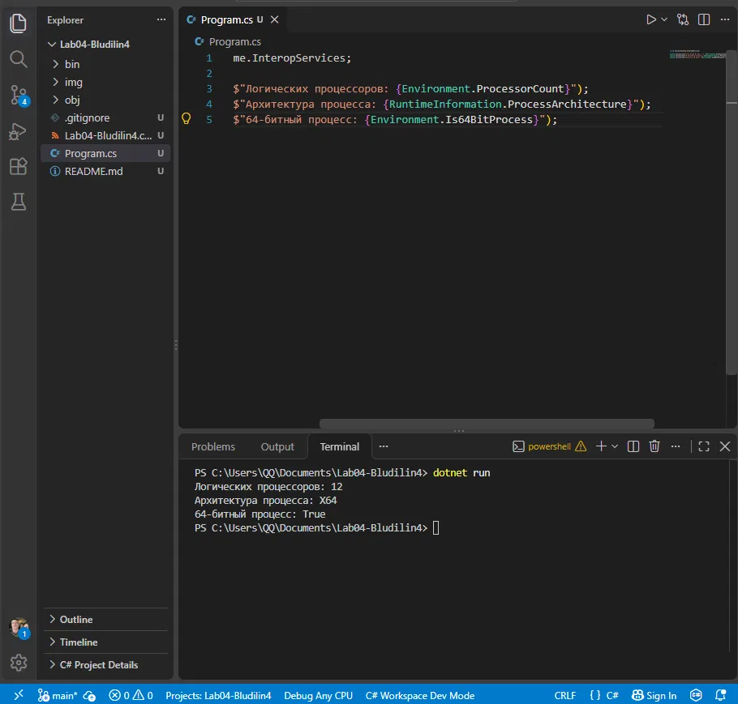
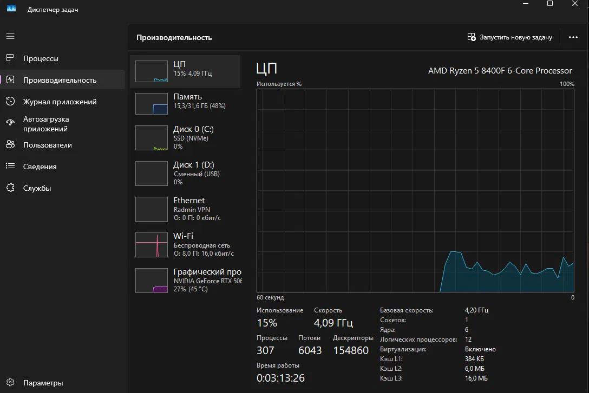
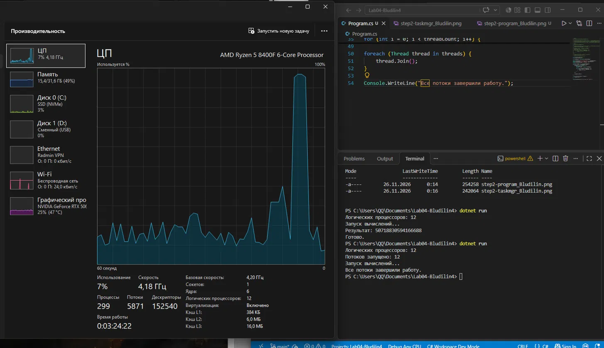

## Шаг 2. Что видит программа

```
Логических процессоров: 12
Архитектура процесса: X64
64-битный процесс: True
```



Диспетчер задач (AMD Ryzen 5 8400F): ядра 6, логические процессоры 12, базовая скорость 4,20 ГГц.



**Почему ProcessorCount сравнивают с логическими процессорами?**
Он показывает логические процессоры, а не физические ядра. У меня 6 ядер, по 2 потока на ядро, поэтому 12.

## Шаг 3. Один поток

Загрузка около 25%. Частота выросла с 4,09 до 4,30 ГГц.

## Шаг 4. Несколько потоков



12 потоков, загрузка 95-100%. Намного больше, чем с одним потоком.

## Шаг 5. Разное количество потоков

| Потоков | Загрузка CPU |
|---|---|
| 1 | ~25% |
| 2 | ~30% |
| 4 | ~40% |
| 8 | ~80-85% |
| 16 | ~98% |

**Вывод:** чем больше потоков, тем выше загрузка. Когда потоков больше 12, рост останавливается: все логические процессоры уже заняты.

## Шаг 6. Ядра и логические процессоры

Физические ядра: 6. Логические процессоры: 12. Разница из-за SMT: одно ядро выполняет два потока.

## Шаг 7. Частота

В простое 4,09 ГГц, под нагрузкой 4,30 ГГц. Процессор сам меняет частоту под нагрузку и температуру.

## Итоговый вопрос

4 ядра × 2 потока (SMT) = 8 логических процессоров. `ProcessorCount` показывает именно их, поэтому противоречия нет.

## Контрольные вопросы

1. **Что показывает Environment.ProcessorCount?** Число логических процессоров.
2. **Ядро и логический процессор?** Ядро это физический блок, логический процессор это то, как его видит система. Одно ядро может давать два.
3. **Почему больше потоков увеличивает загрузку?** Каждый поток занимает свой логический процессор.
4. **Почему потом не растёт?** Все логические процессоры уже заняты, лишние потоки ждут.
5. **Почему меняется частота?** Процессор сам подстраивает её под нагрузку и температуру.

## Итоговый вывод

У моего процессора 6 ядер и 12 логических процессоров из-за SMT. Загрузка росла с ~25% на одном потоке до ~98% на 16. После 12 потоков рост остановился, потому что все логические процессоры были заняты.